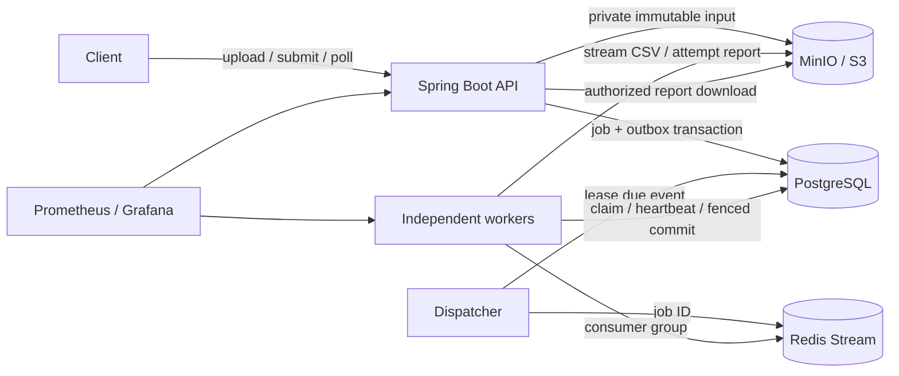

# TaskForge

[](https://github.com/ayugpoudel/taskforge/actions/workflows/ci.yml)

A Java 21/Spring Boot platform that accepts CSV analytics jobs, distributes work across independent workers, and makes recovery behavior inspectable through PostgreSQL state, tests and operational metrics.

**Implemented and locally validated:** streaming CSV reports, authenticated owner-scoped APIs, PostgreSQL job/attempt state, Redis Streams consumer groups, transactional outbox, request idempotency, worker leases/heartbeats/fencing, durable retries, cancellation/deadlines, admission/storage budgets, private MinIO artifacts, retention, JSON logs, Prometheus and Grafana. **43 executed tests passed**, with no skipped integration tests. Two independent worker processes completed a verified real CSV batch; a controlled worker pause/restart was diagnosed through the dashboard and recovered correctly.

**In progress:** controlled scaling benchmarks, final reliability review and cloud deployment configuration. AWS is not deployed. Do not interpret local tests as a guarantee for arbitrary failures or production traffic. The engineering journal records each tested milestone; resume claims must follow that evidence.

## Why this exists

A large report should not tie its lifetime to an HTTP request. TaskForge returns a durable job ID, performs bounded-memory analysis in another process, and exposes the result only after a guarded commit. The interesting problem is the gap between accepting work, delivering notifications, executing an attempt and committing one authoritative result.



## Run locally

Prerequisites: Java 21, Docker Desktop/Engine with Compose, Python 3 for setup/smoke scripts. On this Mac, select Java 21 with `export JAVA_HOME=$(/usr/libexec/java_home -v 21)`; the system default Java may differ.

```sh
./scripts/start-local.sh
```

This generates private random local credentials, builds the application and the pinned MinIO source fixture, and starts PostgreSQL, Redis, MinIO, API, dispatcher, two workers, Prometheus and Grafana. The initial storage build downloads Go dependencies and takes longer than a cached start. MinIO's community repository is archived and historical container distribution changed; the pinned source build is a local compatibility fixture, not an internet-facing production recommendation. Managed S3 is the cloud design.

- API: `http://127.0.0.1:8080`
- Prometheus: `http://127.0.0.1:19090`
- Grafana: `http://127.0.0.1:13000/d/taskforge` (user `taskforge`, generated password in `.env`)
- MinIO console: `http://127.0.0.1:19001` (generated server credentials in `.env`)

All published ports bind to loopback. `.env` is ignored; never publish its values. The generated bearer tokens map to `alice` and `bob`; there is no admin token by default. Development token auth is intentionally small, not a full identity provider.

## API example

Use one owner's token from `.env` as `TOKEN` in your shell; do not paste it into public logs. Use `datasetId` from the first response and `jobId` from the second:

```sh
curl -H "Authorization: Bearer $TOKEN" -F file=@sales.csv http://127.0.0.1:8080/api/datasets
curl -H "Authorization: Bearer $TOKEN" -H 'Content-Type: application/json' -H 'Idempotency-Key: sales-report-1' \
  -d '{"datasetId":"DATASET_UUID"}' http://127.0.0.1:8080/api/jobs
curl -H "Authorization: Bearer $TOKEN" http://127.0.0.1:8080/api/jobs/JOB_UUID
curl -H "Authorization: Bearer $TOKEN" http://127.0.0.1:8080/api/jobs/JOB_UUID/result -o report.json
curl -X POST -H "Authorization: Bearer $TOKEN" http://127.0.0.1:8080/api/jobs/JOB_UUID/cancel
```

Same owner/key/payload returns the existing job; a conflicting payload returns 409. Another owner cannot read the dataset, job, attempt history or report. Reports return 409 before success and 410 after logical expiry. CSV errors are permanent; transient failures use bounded durable retry scheduling. An explicitly configured admin identity can replay eligible failed jobs while retaining history.

## CSV semantics

JSON reports include row/valid/invalid counts, bounded invalid-record numbers, column names/types/missing counts and numeric count/min/max/sum/mean. Invalid-width rows are counted and excluded from column aggregates. Malformed quoting, invalid UTF-8, NUL, duplicate/blank headers and field/column limits reject the job. Quoted multiline cells and UTF-8 BOM are supported. Numeric statistics cover numeric cells; mixed columns are strings. Arithmetic uses DECIMAL128. Files stream through at most 256 columns and 65,536 characters per field; the upload limit is 50 MiB. No synthetic sleeps are used as the application workload.

## Guarantees and boundaries

PostgreSQL records accepted jobs and outbox events atomically. Publication and delivery may repeat. A live DB lease and generation protect completion; every attempt writes a distinct object, and only one guarded pointer is exposed. Processing is **at least once**, not exactly once. Redis is a recoverable notification transport: pending recovery consults database state, and reconciliation reconstructs notifications after Redis loss. AOF everysec alone is not lossless.

Cancellation is logically atomic with completion, but physical computation stops cooperatively. Total deadlines include waiting/retries. Cleanup protects active and authoritative objects, but is eventual. Local Compose is a single-host environment, not a highly available cloud deployment. See [architecture](docs/ARCHITECTURE.md) and [ADRs](docs/adr/).

## Tests and evidence

```sh
docker build -f infra/Minio.Dockerfile -t taskforge-minio:2025-10-15 .
./gradlew clean check bootJar
python3 scripts/e2e.py --jobs 20 --rows 20000 --require-processes 2
python3 scripts/observability_check.py
```

Required integration tests use real PostgreSQL, Redis and MinIO through Testcontainers and fail setup rather than silently skip when Docker is unavailable. They include competing claims/submissions, stale generations, post-publish dispatcher failure, real Redis/PostgreSQL restarts, cancellation/completion races, quotas, upload security and artifact cleanup. [Executed test evidence](docs/TESTING.md), [engineering journal](docs/ENGINEERING_JOURNAL.md), [functional batch](docs/evidence/phase2-e2e.json), [dashboard diagnosis](docs/evidence/phase6-observability.json).

## Learn the design

- [Architecture and alternatives](docs/ARCHITECTURE.md)
- [Requirements](docs/REQUIREMENTS.md) and [roadmap](docs/ROADMAP.md)
- [Decision log](docs/DECISION_LOG.md) and [individual ADRs](docs/adr/)
- [Observability](docs/OBSERVABILITY.md)
- [Interview notes](docs/INTERVIEW_NOTES.md)
- [Benchmark protocol and status](docs/BENCHMARKS.md)
