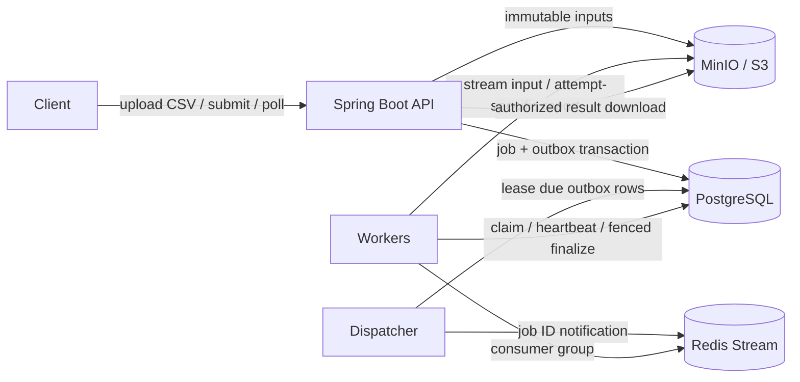

# TaskForge architecture

Status: phase 0 design accepted; execution evidence lives in TESTING.md and the engineering journal.

PostgreSQL is authoritative. Redis holds disposable notifications, never the only durable evidence of accepted work. A database reconciliation pass must restore notifications lost by Redis. Workers claim short database leases; CSV computation runs outside transactions. Completion is conditional on generation, ownership, live lease, state, cancellation, and deadline. Attempt-specific output keys isolate stale uploads. Only the database's finalized pointer is client-visible.

## Queue comparison

| Option | Solves / advantages | Limitations and performance | Operations / choose when |
| --- | --- | --- | --- |
| Redis Streams | Shared consumer groups, pending entries, acknowledgement, learning explicit recovery | At least once; AOF everysec can lose recent writes; retention can delete needed entries; DB reconciliation required | Moderate: Redis memory/persistence plus consumer lifecycle. Chosen learning target, not required for async work. |
| RabbitMQ | Purpose-built work distribution, acknowledgements, publisher confirms, prefetch | Broker confirmation is not application completion; duplicate processing still possible | Moderate broker administration; prefer when routing/work queues dominate and fewer custom stream semantics are desired. |
| Amazon SQS standard | Managed work queue, visibility timeouts, scaling without operating a broker | At least once, remote API latency, message size/retention boundaries; AWS coupling/cost | Low broker operations but IAM/network/cost; attractive on AWS. No cloud resources created here. |
| PostgreSQL SKIP LOCKED | Atomic durable claims beside job state; fewest components | Polling/lock/index churn, database carries scheduling and application load; skip-locked ordering is not strict fairness | Lowest component count; often the better initial production choice at modest volume. Used for phase 1 local slice and later outbox leasing. |

Redis is chosen to study delivery/acknowledgement/recovery independently from durable state. Its extra failure domain must earn its place through experiments, not assumed throughput superiority.

## Processing comparison

| Option | Benefit | Limitation / performance | Decision |
| --- | --- | --- | --- |
| Synchronous HTTP | Few components, immediate errors/results | Occupies request resources; long requests time out; client retries can repeat work | Only short low-cost analytics. |
| API background executor | Easy local async prototype | Work lifecycle/scaling tied to API; in-memory tasks lost on restart without persisted claims | Phase 1 uses durable DB polling in an independent local worker role instead. |
| Independent workers | Separate resource budgets, fault isolation, horizontal scaling | Deployment/lease/recovery complexity; throughput limited by CPU, database or storage | Chosen; one artifact configured by process role, not separate microservice codebases. |

## Storage comparison

| Option | Benefit | Cost / performance | Decision |
| --- | --- | --- | --- |
| PostgreSQL for metadata and files | One transaction/store, simple permissions | Large blobs inflate WAL/backups and compete with state queries | Suitable for small bounded payloads only. |
| PostgreSQL metadata + object storage | Streaming large files, immutable keys, independent storage | No cross-store transaction; orphan cleanup required; uploads can precede failed DB commit | Chosen. MinIO local; S3 configuration later. No object may overwrite another attempt's result. |

## Guarantees to validate

Acceptance occurs after input storage and job/outbox commit. This does not protect against permanent loss of all PostgreSQL/object-storage copies. Execution can repeat. One authoritative result pointer per logical job is enforced by fenced conditional writes; arbitrary external effects are out of scope. Retries and cancellation must be durable state transitions. Queue idle time alone must never override a live database lease.

## References verified before coding

- [Spring Boot 3.5 requirements](https://docs.spring.io/spring-boot/3.5/system-requirements.html): Java 21 compatible; Gradle 8.4+ supported. Selected 3.5.16, confirmed in Maven Central metadata, and Gradle 8.14.3.
- [Redis XREADGROUP](https://redis.io/docs/latest/commands/xreadgroup/), [XCLAIM](https://redis.io/docs/latest/commands/xclaim/), [XAUTOCLAIM](https://redis.io/docs/latest/commands/xautoclaim/): delivery ownership differs from application lease ownership.
- [RabbitMQ acknowledgement/confirmation](https://www.rabbitmq.com/docs/confirms): separate producer and consumer guarantees.
- [SQS standard delivery](https://docs.aws.amazon.com/AWSSimpleQueueService/latest/SQSDeveloperGuide/standard-queues-at-least-once-delivery.html): consumers must tolerate duplicates.
- [PostgreSQL row locking](https://www.postgresql.org/docs/current/sql-select.html): SKIP LOCKED for queue-like work, not a globally consistent view.
