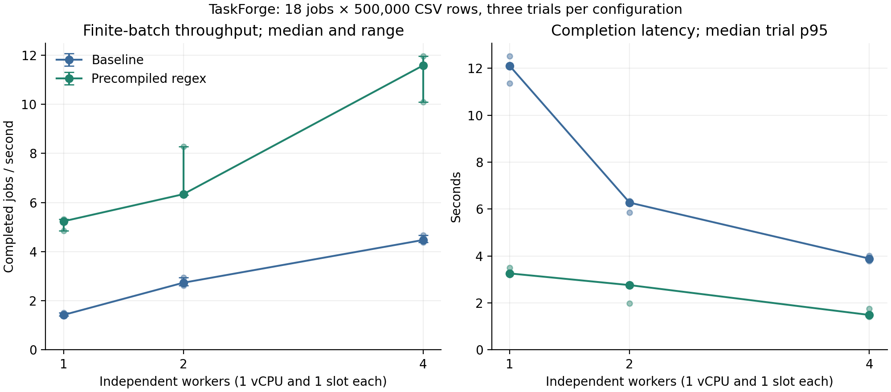

# Executed benchmark report

Measured on November 19, 2026. Raw data, exact parameters and charts are in [benchmarks/](benchmarks/). These are controlled local finite batches, not production capacity or an SLA.



## Protocol and environment

- Java 21/Spring Boot, Docker Desktop 28.3.2 on macOS 15.1 arm64; Docker VM: 11 vCPUs and 8,217,890,816 bytes memory.
- Each independent worker: **1 vCPU quota, 512 MiB memory, one execution slot**, six-second lease with separate heartbeats. The override is `compose.benchmark.yml`; the normal application defaults are different.
- Three measured trials per version/worker count, **18 jobs per trial**, **500,000 rows and 6,833,355 bytes per CSV**. Two numeric columns contain `i` and `2*i`. One immutable uploaded dataset is reused; upload time is excluded.
- Warmup is explicit and excluded (2, 4, 8 jobs for 1, 2, 4 workers). The client submits each batch with four concurrent HTTP requests and verifies every result using independently computed arithmetic.
- Throughput = accepted jobs / interval from first durable creation to last durable finalization. Queue/execution/completion times come from PostgreSQL timestamps. API acknowledgement latency uses the client monotonic clock. Polling/report downloads do not define completion time.
- Medians are across three trials; ranges show min/max, not confidence intervals. p95 values below are median trial p95, each interpolated from 18 jobs. Raw p50/p95/p99 and sample counts are retained; this is insufficient for strong tail-latency claims.
- Baseline application commit/protocol: `4009f9c`; optimized: `84a913b`. Each raw file records its exact image ID, CPU/memory limits, dataset hash and source commit. Final audit changes do not retroactively change those measurements.

## Results

| Version | Workers | Median jobs/s | Trial range | Median trial completion p95 | Median API p95 |
| --- | ---: | ---: | ---: | ---: | ---: |
| Baseline | 1 | 1.418 | 1.373–1.509 | 12.102 s | 17.3 ms |
| Baseline | 2 | 2.731 | 2.624–2.940 | 6.273 s | 28.6 ms |
| Baseline | 4 | 4.471 | 4.373–4.670 | 3.886 s | 22.5 ms |
| Precompiled regex | 1 | 5.234 | 4.857–5.318 | 3.254 s | 24.5 ms |
| Precompiled regex | 2 | 6.337 | 6.308–8.274 | 2.756 s | 28.3 ms |
| Precompiled regex | 4 | 11.582 | 10.087–11.965 | 1.484 s | 17.7 ms |

All 324 measured-trial reports were verified; warmup jobs are additional. Baseline one→four worker median scaling was **3.154×**. The isolated numeric-pattern change raised observed one-worker median throughput **3.692×**, from 1.418 to 5.234 jobs/s. Optimized one→four scaling was **2.213×**, not linear. The larger two-worker trial range is retained rather than discarded.

## Bottleneck and optimization

The baseline stage snapshot showed mean calculation time ~0.704 s versus input reads ~0.013 s and finalization ~0.0014 s. This snapshot aggregates current worker lifetimes, including warmup; it is stage evidence, not a per-trial CPU profile. Source inspection found `String.matches` recompiling the same numeric regex per cell. One immutable precompiled Pattern keeps the exact regex/matching semantics while avoiding that repeated compilation. CSV validation tests passed before repeating the same benchmark protocol.

The measurements support that optimization on this numeric workload. They do not establish a universal improvement for all CSV contents. Sequential A/B order, shared host activity, JIT/GC and OS caching were not fully isolated/randomized.

During the longer sustained scenario, sampled worker CPU averages were roughly 94–103% of one core and peak observed worker memory roughly 259–268 MiB. API ~33%, PostgreSQL ~14%, Redis ~1% and MinIO ~22% CPU were lower. These coarse Docker snapshots suggest calculation remains the main per-worker resource demand; they do not prove a particular cache/GC/memory-bandwidth bottleneck. Short batches also pay fill/drain, polling and shared-service overhead. Four workers improve absolute throughput but do not deliver four times the optimized one-worker figure. Before further tuning, run longer randomized batches and JFR/GC profiles; do not assume the database or Redis needs replacing.

Memory figures are observed Docker working-memory snapshots, not measured worst-case bounds. The parser's algorithmic memory bound follows columns/field-size limits; large-file completion is a separate functional check. Resource snapshots and their counts are retained in `resource-summary.json` and each raw run.

## Load and failure scenarios

All **768 accepted jobs** below finished successfully and their reports were independently checked. Each scenario is one functional experiment; these are not repeated scaling comparisons.

| Scenario | Jobs | CSV rows/job | Durable batch duration | Observation |
| --- | ---: | ---: | ---: | --- |
| Small/low load | 8 | 10,000 | 0.499 s | Accurate reports. |
| Large CSV | 8 | 1,000,000 | 1.275 s | Real streaming workload, not sleeps. |
| Mixed sizes | 12 | 10k / 250k / 1m | 1.039 s | Interleaved sizes verified individually. |
| Burst | 100 | 10,000 | 0.846 s | All accepted and completed. |
| Sustained pressure | 600 | 250,000 | 16.409 s | Target 60 submissions/s for ~10 seconds; backlog drained afterward. |
| Active worker SIGKILL | 12 | 1,000,000 | 8.047 s | 13 attempts: one expired attempt recovered in a second generation. |
| Redis stop/start (3 s) | 16 | 250,000 | 53.882 s | No lost accepted jobs, but slow publication/recovery. |
| PostgreSQL stop/start (3 s) | 12 | 1,000,000 | 8.638 s | Accepted state survived; this batch recorded no additional attempts. |

The PostgreSQL load case does not establish in-flight heartbeat failure by itself; that is separately exercised in the deterministic integration test. The worker SIGKILL case does establish a recovered in-flight attempt through persisted history.

**Redis limit:** the three-second outage produced a much longer batch delay. Durable timestamps showed the slow jobs queued ~53.5–53.8 s and their only outbox publication at ~52.6 s; the event was delayed before publication, not silently lost. Reconnection/connection acquisition is a follow-up to isolate and bound more explicitly. This observation is not evidence for a guaranteed recovery deadline, and no fast Redis-failover resume claim is supported.

## Reproduce

```sh
./scripts/start-local.sh
python3 scripts/benchmark.py --label reproduced --workers 1,2,4 --trials 3 --jobs 18 --rows 500000 --output benchmarks/runs/reproduced.json
python3 scripts/load_scenarios.py
python3 scripts/plot_benchmarks.py
```

The load script intentionally kills/stops only TaskForge containers; use an isolated local stack with synthetic CSVs. It restores interrupted services. `compose.benchmark.yml` changes worker resources; return to normal settings afterward with `docker compose up -d --scale worker=2 --wait`. The plot script uses Matplotlib and reads the archived baseline/optimized files; it does not rerun the experiment or invent data. Plotting dependencies are separate from the Java application.

## Redis follow-up at 46d1144

Repeating the three-second Redis interruption with 16 jobs of 250,000 rows and four workers took 5.844 seconds from first durable submission to final completion versus 53.882 seconds in the archived run. All 16 reports passed arithmetic checks and there were zero extra attempts. The dispatcher logged connection refusal at 22:47:23.933 UTC and reconnection at 22:47:28.237 UTC. The earlier wait preceded publication. These observations locate the delay upstream of worker execution and demonstrate reconnect behavior in the repeat. A single before/after run cannot isolate how much the new two-second connect timeout contributed. [Follow-up data](benchmarks/redis-connection-followup.json).
