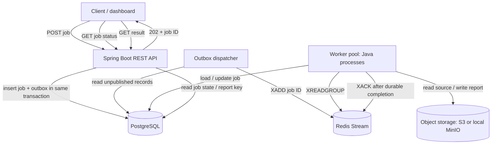

# Distributed Job Processing System — Engineering Notes & Interview Playbook

**Status:** Proposed design; not yet built. **Goal:** Develop a demonstrably reliable asynchronous backend, not just an API demo.  
**Target:** General SWE internships (Google, Meta, Microsoft, Amazon, Roblox).  
**Concrete workload:** A user submits a large CSV dataset and requests an analytics report. Processing can take seconds or minutes; the user should get a job ID immediately and retrieve the report later.

> Accuracy rule: Anything below is an architecture proposal, not an accomplishment. Add metrics or bullets to a resume only after implementing and measuring them.

## 1. Problem statement and requirements

**Problem:** A synchronous `POST /generate-report` request might run for minutes. Clients and gateways can time out, API instances get tied up, and a process crash can strand work. We want to accept requests quickly and execute expensive processing outside the request lifecycle.

**Functional requirements**
1. Submit a report job and receive an ID (`POST /jobs` -> `202 Accepted`).
2. See status and error information (`GET /jobs/{id}`).
3. Download a finished artifact (`GET /jobs/{id}/result`, a validated download or signed URL).
4. Process multiple jobs concurrently, with configurable worker count.
5. Retry temporary failures, bound retry attempts, and expose permanent failures.

**Nonfunctional requirements**
- Durability: accepted jobs aren't silently lost after API or worker crashes.
- At-least-once processing with idempotent results, not a fake exactly-once promise.
- Observable: metrics, traces/logs by job ID, tests, documented failure modes.
- Backpressure: queue backlog is visible and incoming work can be throttled.
- Security: job ownership, validated uploads, no sensitive payloads in queue/logs.

**Out of scope for first version:** Full Kubernetes deployment, Kafka, distributed consensus, extensive billing/multi-tenancy, real-time WebSockets. Add only if grounded in measured need.

## 2. Architecture: what each component does



- **Spring Boot API:** validates the request, authorizes the user, records the job, returns quickly; does not run the heavy computation in the request thread.
- **PostgreSQL:** source of truth for job identity, status, attempts, ownership, output location, errors, timestamps, and outbox events. Gives transactional updates and a useful audit trail.
- **Redis Streams:** hands job IDs to a shared consumer group of workers, tracks pending acknowledgments, and supports reclaiming abandoned messages. Unlike simple Pub/Sub, messages aren't just ephemeral broadcasts. Redis durability settings and topology still matter.
- **Workers:** independent Java processes that pull job IDs, acquire a safe claim/lease, run the transformation, write results, and report status. Scaling workers increases processing capacity until a downstream resource bottlenecks.
- **Object storage:** stores potentially large inputs and output reports. Queue carries only a small ID, never the entire CSV.
- **Observability:** Spring Boot Actuator/Micrometer -> Prometheus -> Grafana; structured logs tagged with `job_id` and `request_id`.

## 3. End-to-end happy path, as a timeline

1. User uploads `sales.csv` to object storage (or uses an already-uploaded dataset) and requests a report with `POST /jobs`.
2. API validates file reference, identity, request parameters, file-size limits and idempotency key.
3. Within a single PostgreSQL transaction, API inserts a `jobs` row as `QUEUED` and an `outbox_events` row. Commit means the job request is durably accepted.
4. API immediately replies `202 Accepted` with `job_id` and status URL. A client can poll without waiting for computation.
5. Background dispatcher reads an unpublished outbox row and publishes `{job_id}` to a Redis Stream (e.g. `report-jobs`) via `XADD`. It marks the outbox event delivered; repeat publication is possible if dispatcher crashes at an unlucky instant.
6. A free worker receives the message via `XREADGROUP`. The worker atomically claims the job in PostgreSQL (compare state/version or lease ownership) so two workers don't both assume ownership.
7. Worker moves job to `RUNNING`, streams the input data, validates records, calculates aggregates, and creates a report in a temporary location. Large files should not be read entirely into RAM by default.
8. Worker writes the finished output to object storage. It records the output key and marks the database job `SUCCEEDED` in a transaction, using a conditional update protected by claim/lease ownership. Only **after** the durable final-state update does it `XACK` the Redis entry.
9. Client polls `GET /jobs/{id}` and sees `SUCCEEDED`, then downloads result from an authenticated endpoint or short-lived signed URL.

**Example HTTP response (illustrative):**

```json
{ "job_id": "j_123", "status": "QUEUED", "status_url": "/jobs/j_123" }
```

**Example state transitions:** `QUEUED -> RUNNING -> SUCCEEDED`; on transient errors: `RUNNING -> RETRY_WAIT -> QUEUED -> RUNNING`; after max attempts or permanent validation failure: `FAILED` (optionally route to dead-letter review). Treat retries as state machine transitions, not arbitrary sleeps.

## 4. Failure scenarios (learn these for interviews)

| Failure | Risk | Response / tradeoff |
|---|---|---|
| API crashes **before** DB commit | Request might not exist | Client retries with same idempotency key; no acceptance response was guaranteed. |
| API commits DB but Redis is down | Accepted job never reaches workers if publishing only once | Transactional outbox and dispatcher retries; don't try an unsafe DB+Redis dual write. |
| Dispatcher publishes then crashes before marking outbox sent | Duplicate message | At-least-once delivery is acceptable; enforce idempotent claiming/processing. |
| Worker crashes in the middle of a job | Job remains pending | Consumer group pending entry + lease timeout/reclaim/reconciliation; another worker takes over. |
| Worker finishes report but crashes before `XACK` | Same job could be delivered twice | Deterministic output key or idempotent job state prevents duplicate visible result; ack duplicate after verified completion. |
| Data source is invalid | Retrying won't help | Mark permanent failure and expose a sanitized error. |
| S3 or DB temporarily unavailable | Temporary failure | Exponential backoff with jitter, max attempts, and retry telemetry. |
| Queue grows faster than workers consume | Large waits and memory growth | Rate limiting, queue-depth metrics, worker autoscaling within safe limits, bounded payloads and retention. |
| One worker hangs while another claims expired lease | Concurrent write conflict | Lease renewal/fencing token and conditional completion, not naive timeout alone. |

**Most important distinction:** *At-least-once delivery* is not *exactly-once execution*. Duplicate execution can happen after crashes or recovery. Design the **observable result** to be idempotent: repeating an action should not yield extra effects (such as duplicate reports, charges, or emails). For report generation, use a stable result location and a status compare-and-set with a unique job ID. For external side effects such as payment or email, stronger application-specific deduplication and transactional design are needed.

## 5. Decisions and tradeoffs: what to say and why

| Decision | Why this option? | Alternatives and when they win |
|---|---|---|
| **Async jobs over synchronous requests** | Fast API response; jobs can run longer, retry, and scale separately | Synchronous request is simpler for short low-cost tasks. |
| **Java + Spring Boot** | Existing language strength; strong REST, SQL, testing, metrics ecosystem; easier to defend in an interview | Go could be lighter for concurrency; Python is convenient for data science workloads; choose by requirements, not resume buzzwords. |
| **PostgreSQL for status** | Durable, queryable records and transactions | Redis-only state is simpler but weaker for audit/reconciliation. |
| **Redis Streams for queue** | Consumer groups, acknowledgment and pending-message recovery with little extra infrastructure | RabbitMQ is purpose-built for work queues, SQS avoids managing a broker on AWS, Kafka shines for event logs/replay at scale. Redis simple lists and Pub/Sub lack the same failure-handling semantics. |
| **Multiple worker processes** | Independent scaling and fault isolation; queue distributes jobs | API background threads are easier but tie processing to API instance lifecycle. |
| **Transactional outbox** | Avoid silent loss between DB commit and queue publish | Direct DB then Redis publish is simple for MVP but has a dual-write failure gap. |
| **At-least-once + idempotency** | More practical than claiming exactly-once; works with crash/retry scenarios | True exactly-once across DB, broker, object storage and arbitrary side effects is not generally guaranteed. |
| **Polling GET /jobs** | Straightforward and reliable for MVP | WebSockets/SSE for rich live progress at cost of connection management. |
| **Object storage for large files** | Avoid database blobs and huge queue payloads | Local filesystem works only for local MVP; cloud object storage aids scaling. |
| **Docker Compose first** | Easy reproducible local environment | Kubernetes only when scaling/operations justify complexity. |

**Complexity warning:** Start with a reliable minimal vertical slice. It is acceptable to implement a direct DB-plus-Redis publish initially **if explicitly documented as a weakness**, then add an outbox and failure tests before calling it reliable. Alternatively start with a PostgreSQL-only queue (rows claimed by workers with `SKIP LOCKED`) and add Redis after proving a need; this is a defensible simpler design. Don't pretend Redis is required to make an async queue.

## 6. Database sketch (suggested, not final)

`jobs(id UUID PK, owner_id, type, payload_ref, status, attempt_count, max_attempts, lease_owner, lease_expires_at, version, output_ref, error_code, created_at, started_at, finished_at, idempotency_key)`

`outbox_events(id UUID PK, job_id FK, event_type, payload, published_at, attempts, created_at)`

Recommended constraints: unique `(owner_id, idempotency_key)` when key present; index `(status, created_at)`; index `lease_expires_at` for recovery. Use conditional updates (e.g., WHERE id=? AND version=? or WHERE lease_owner=?) to guard concurrent completion.

## 7. API shape and operational semantics

- `POST /jobs` with `dataset_id` and output type, plus `Idempotency-Key` header; returns `202` and job ID. Reject invalid inputs, excessive file sizes, or quota violations.
- `GET /jobs/{jobId}` returns status, attempt count, timestamps, and safe error code. Authorization checks job ownership.
- `GET /jobs/{jobId}/result` returns 404/409 until ready; then a short-lived signed download URL or streams the report.
- Optional `POST /jobs/{jobId}/cancel` should be deferred until worker cancellation semantics are designed.
- For transient errors, schedule retries using backoff and jitter; ensure delayed retries aren't instantly reclaimed and hot-looping.
- Set timeouts, concurrency limits, payload-size limits, and data retention policies. Don't log input rows or secrets.

## 8. Test & measurement plan

**Tests:**
- Unit: state transitions, backoff, idempotency-key handling, report computation.
- Integration: real PostgreSQL + Redis via Testcontainers; end-to-end job submission -> completion.
- Failure injection: kill worker during processing; stop Redis after DB commit; stop dispatcher after publish; replay duplicate messages; simulate DB outage; malformed CSV; expired lease.
- Load: fixed job sizes and a mix of fast/slow jobs, comparing 1 vs. 2 vs. 4 workers across several repeated trials. Include host CPU/memory and DB utilization to interpret bottlenecks.

**Metrics to record:**
- **API p95 latency:** 95th percentile time to acknowledge submissions; different from total job duration.
- **Queue wait p95:** created/queued -> started.
- **Processing duration p95:** started -> succeeded/failed.
- **End-to-end completion p95:** request accepted -> finished.
- **Throughput:** successfully completed jobs per minute.
- **Reliability:** completion rate, retries per job, dead-letter count, duplicates suppressed, stuck jobs recovered.
- **Resources:** CPU, memory, queue depth, active workers and database connections.

**Benchmark hygiene:** Compare same dataset and hardware, document test method, warm-up, measurement period, sample size, repeated runs, and failure conditions. Never claim a measured percentage before conducting the test.

## 9. A practical build order (concept before code)

### Milestone A — Simplest useful service
- Build a synchronous CSV summary function with unit tests.
- Add `POST /jobs`, Postgres job record, `GET /jobs/{id}`.
- Add a single background worker. Demonstrate the API returns before the report finishes.
- Use local filesystem/MinIO in development; store only pointers in Postgres.

**Interview learning:** Why asynchronous processing? Difference between API response time and completion time. Why database records represent state.

### Milestone B — Distributed execution
- Add Redis Streams consumer group, independent worker containers and two or more workers.
- Add claim/ack semantics, safe state transitions, retry limits and exponential backoff.
- Run several jobs in parallel, observe worker distribution.

**Interview learning:** Why a queue? What happens after consumer crashes? Delivery vs processing guarantees.

### Milestone C — Make acceptance and recovery reliable
- Add idempotency keys and conditional updates; persist results with stable output IDs.
- Add transactional outbox and dispatcher, lease expiry/reclaim, deduplicated completion.
- Build fault-injection test suite: crash workers and dispatcher at the worst possible times.

**Interview learning:** Dual-write problem, at-least-once, idempotency, transactions, duplicate handling.

### Milestone D — Deploy, observe, benchmark
- Containerize API, dispatcher, and workers; GitHub Actions tests; deploy to AWS if feasible.
- Add Actuator/Micrometer, Prometheus/Grafana dashboards, structured logs.
- Benchmark throughput, queue time, p95 API latency; explore worker count and bottlenecks.

**Interview learning:** Horizontal scaling, bottlenecks, observability, deployment choices, cost/reliability tradeoffs.

## 10. Architecture Decision Record (ADR) template — fill each time

```md
# ADR-00X: [Specific decision]
Date: YYYY-MM-DD
Status: Proposed / Accepted / Superseded
Context: What problem/constraint motivated this?
Options: A / B / C
Decision: Which option and why?
Tradeoffs: What complexity, risk, cost or limitation did we accept?
Evidence: Link to benchmark, code, docs or failure test.
Revisit when: What future data/scale would change our choice?
Interview explanation: In 2 sentences, explain what and why.
```

**Suggested first ADRs:**
- ADR-001: Async job queue instead of synchronous report generation.
- ADR-002: PostgreSQL as source of truth instead of Redis-only job status.
- ADR-003: PostgreSQL-only queue vs Redis Streams vs SQS.
- ADR-004: At-least-once processing, idempotency, and retry policy.
- ADR-005: Transactional outbox to close the DB-to-queue dual-write gap.
- ADR-006: Polling vs WebSockets for status updates.
- ADR-007: Backpressure and worker scaling strategy.

**Daily engineering journal:**
- What did I build today?
- What design choice did I make, and what did I reject?
- What broke? How did I reproduce and fix it?
- What did I measure? Record command, hardware, dataset and numerical result.
- What would I change with 10x traffic or a service outage?
- What can I explain now without looking at code?

## 11. Interview story — adapt after building

**30-second pitch (future-state template; only use once true):**
> I built an asynchronous report-processing service in Java and Spring Boot. Instead of keeping HTTP requests open for expensive CSV jobs, the API records a job in PostgreSQL and returns an ID. Redis Streams distributes work to independent workers. The harder engineering work was making jobs recoverable and idempotent: I added retries, crash recovery and an outbox to avoid losing accepted jobs when publication fails. Then I load-tested the system and measured how throughput and queue wait changed as I increased worker count.

**Deeper 2-minute explanation:**
1. Start with the exact user-facing problem and why synchronous processing was unacceptable.
2. Walk a job through API -> Postgres+outbox -> Redis -> worker -> output object storage -> status endpoint.
3. Explain one failure injected deliberately (e.g., worker crashes after output before ack).
4. Explain what you changed (idempotent output, conditional state updates, reclaim), and show test evidence.
5. Explain quantified measured improvement, limits, and what you would do differently at larger scale.

**Questions you should be able to answer without notes:**
1. Why not execute the CSV processing in a Spring controller thread?
2. Why keep both PostgreSQL and Redis? Could one system suffice?
3. What happens if the API commits the job but Redis goes down?
4. What happens if the dispatcher publishes a message twice?
5. What happens if a worker finishes processing but crashes before acknowledging?
6. What does "at least once" actually guarantee? What doesn't it guarantee?
7. How does an idempotency key differ from an idempotent worker?
8. How do multiple workers avoid overwriting each other's result?
9. Why can't you promise linear throughput improvement with more workers?
10. What would you measure before deciding to add more workers?
11. How would you keep retries from overwhelming a failing database?
12. How would you secure file access and prevent one user from reading another user's report?

## 12. Resumé evidence checklist (fill **after** implementation)

- Repo link / deployment demo: _______
- Core stack actually used: _______
- Job types actually implemented: _______
- Number of workers tested: _______
- Workload specification, dataset size: _______
- API p95 latency measured: _______
- Throughput at 1 worker and N workers: _______
- Failure tests passed: _______
- Observability tools enabled: _______
- CI/CD pipeline + test count: _______
- Most important tradeoff and what changed after measurement: _______

**Possible resume bullet structures — never copy without evidence:**
- "Engineered a Java/Spring Boot asynchronous job service using [queue] and [database], supporting [verified feature]."
- "Designed idempotent [retry/recovery pattern], recovering [verified failure mode] in [verified tests]."
- "Benchmarked [N] workers processing [dataset], achieving [measured throughput] with [measured p95]."

## 13. Official technical references

- Redis Streams consumer group fundamentals: https://redis.io/docs/latest/develop/use-cases/streaming/
- Redis `XREADGROUP`: https://redis.io/docs/latest/commands/xreadgroup/
- Redis `XACK`: https://redis.io/docs/latest/commands/xack/
- AWS transactional outbox: https://docs.aws.amazon.com/prescriptive-guidance/latest/cloud-design-patterns/transactional-outbox.html
- Spring Boot metrics/Actuator: https://docs.spring.io/spring-boot/reference/actuator/metrics.html

---
**Principle to remember:** The strongest interview project isn't the one with the most services. It is the one where you can explain the problem, justify the design, show a failure, demonstrate a fix, and produce measured evidence.
